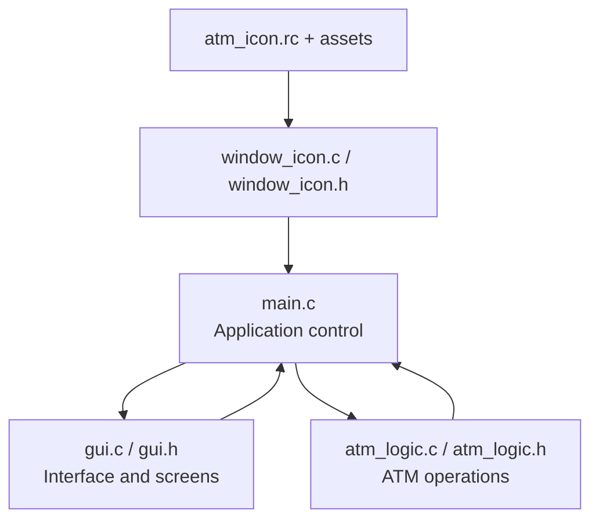

# ATM Simulator

A C-based ATM simulation project that demonstrates the evolution from command-line prototypes to a modular graphical desktop application built with [Raylib](https://www.raylib.com/).

The project models common ATM workflows, including customer authentication, deposits, withdrawals, transaction history, cash inventory management, and administrative operations. It is intended for learning and demonstration—not for processing real financial transactions.

## Table of Contents

- [Project Overview](#project-overview)
- [Features](#features)
- [Project Structure](#project-structure)
- [Architecture](#architecture)
- [Technology Stack](#technology-stack)
- [Build and Run](#build-and-run)
- [Demo Configuration](#demo-configuration)
- [Limitations](#limitations)
- [Planned Improvements](#planned-improvements)
- [License](#license)

## Project Overview

ATM Simulator is organized into three development stages:

1. **Console Prototype 1** — an initial command-line implementation of ATM withdrawal functionality.
2. **Console Prototype 2** — an expanded command-line simulation with additional customer, transaction, and administrative workflows.
3. **Graphical ATM Application** — a desktop interface built with Raylib, supported by a separate ATM logic module.

The graphical application separates interface rendering from core ATM operations. This makes the code easier to navigate, maintain, and extend than a single-file implementation.

## Features

### Customer operations

- Customer card-number and PIN authentication.
- Balance enquiry.
- Cash withdrawal with automatic or manual denomination selection.
- Cash deposits.
- Transaction history.
- Transaction reversal.

### ATM cash management

- Cash inventory tracked by denomination.
- Supported denominations: 500, 200, 100, and 50.
- Automatic note selection based on available inventory.
- Cash replenishment and removal.
- ATM cash-capacity tracking.

### Administrative operations

- Administrator authentication.
- Customer failed-login tracking and card blocking.
- Daily withdrawal-limit management.
- Maintenance-mode control.
- Simulated cash-dispenser and deposit-slot failures.
- Transaction and activity reporting.

### Graphical interface

- Raylib-based desktop interface.
- Separate screens for customer and administrator workflows.
- Dedicated GUI and ATM-logic modules.
- Windows application icon resources.

> The application uses simulated accounts, balances, cash inventory, and hardware states. It does not connect to a bank or payment network.

## Project Structure

```text
ATM-Simulator/
├── .gitignore
├── Foundation/
│   ├── ATM_SIM_1.c
│   └── ATM_SIM_2.c
└── Graphical-ATM/
    └── ATM_Desktop/
        ├── main.c
        ├── gui.c
        ├── gui.h
        ├── atm_logic.c
        ├── atm_logic.h
        ├── window_icon.c
        ├── window_icon.h
        ├── atm_icon.rc
        └── assets/
            ├── Glossy Blue ATM Bank Icon.ico
            └── atm_icon.png
```

## Architecture

The graphical application is divided into three primary responsibilities:

| Module | Responsibility |
| --- | --- |
| `main.c` | Application entry point, main loop, screen flow, and input coordination. |
| `gui.c` / `gui.h` | Interface rendering, UI components, and screen-specific presentation. |
| `atm_logic.c` / `atm_logic.h` | Authentication, account operations, transaction processing, cash inventory, and administrative logic. |
| `window_icon.c` / `window_icon.h` | Windows application icon handling. |
| `atm_icon.rc` | Windows resource declaration for the application icon. |

The intended interaction between the main modules is:



The GUI presents information and gathers user input, while the ATM logic module performs the underlying operations and updates the simulation state.

## Technology Stack

- **Language:** C
- **Graphics library:** Raylib 6.2
- **Compiler:** GCC (MinGW-w64)
- **Development environment:** MSYS2 UCRT64
- **Target environment:** Windows desktop

## Build and Run

The following instructions describe the Windows build setup used for this project.

### Prerequisites

Install and configure:

- [MSYS2](https://www.msys2.org/) with the UCRT64 environment.
- GCC / MinGW-w64.
- [Raylib 6.2](https://www.raylib.com/) and its development files.
- The Raylib runtime DLLs required by your build.

Make sure GCC can locate the Raylib headers and libraries, and that the required runtime DLLs are available beside the executable or through your system PATH.

### Compile the graphical application

Open the **MSYS2 UCRT64** terminal and navigate to the graphical application directory:

```bash
cd Graphical-ATM/ATM_Desktop
```

Compile the application:

```bash
gcc main.c gui.c atm_logic.c window_icon.c atm_icon.rc -o ATM_Desktop.exe -lraylib -lgdi32 -lwinmm
```

Run it:

```bash
./ATM_Desktop.exe
```

If the executable starts but Windows reports that a DLL is missing, check that the Raylib runtime DLLs are installed and available to the executable.

### Compile the console prototypes

From the repository root, compile either prototype independently:

```bash
gcc Foundation/ATM_SIM_1.c -o ATM_SIM_1.exe
gcc Foundation/ATM_SIM_2.c -o ATM_SIM_2.exe
```

Run the desired executable from the same terminal:

```bash
./ATM_SIM_1.exe
```

Or:

```bash
./ATM_SIM_2.exe
```

## Demo Configuration

The graphical application uses predefined demo customer accounts and administrator credentials stored in the source code. Review the constants and initial values in `atm_logic.c` and `atm_logic.h` before running the simulation.

These credentials are for local demonstration only. They must not be reused for real accounts or services.

## Limitations

This project is an educational simulation and has important limitations:

- Account data, balances, cash inventory, and transaction history are held in memory and are reset when the application restarts.
- Demo credentials are defined in source code.
- Authentication and transaction handling are simplified for demonstration.
- Hardware faults and maintenance states are simulated in software.
- The project is not connected to banking infrastructure, payment networks, or external financial services.
- No automated test suite is currently included in the repository.

It should not be used to store real financial information or perform real transactions.

## Planned Improvements

Potential next steps include:

- Persistent storage for accounts and transaction records.
- Secure credential handling and password/PIN hashing.
- Automated unit tests for transaction and cash-management logic.
- Stronger input validation and error reporting.
- Improved build configuration and dependency documentation.
- Additional screenshots and a demonstration video.

## License

No license file is currently included in this repository. Until a license is added, the project remains subject to the default copyright rules. Please contact the repository owner before reusing or distributing the code.
